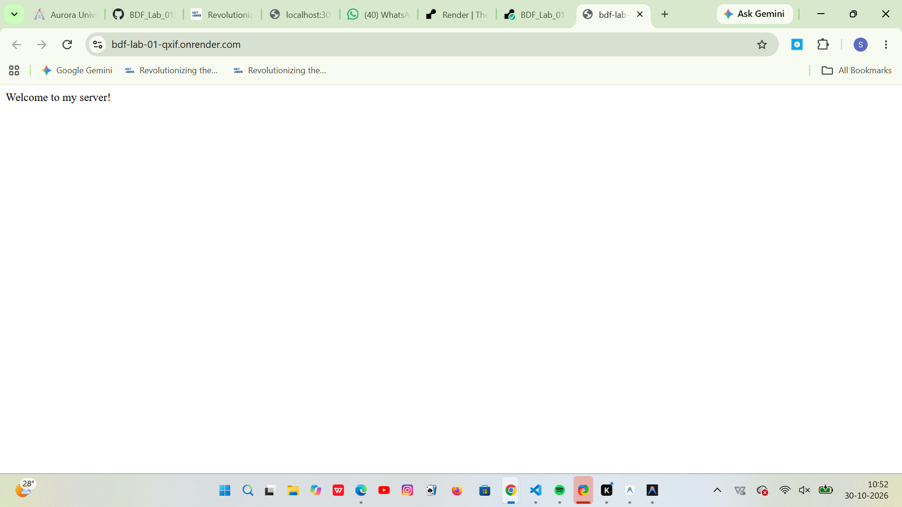
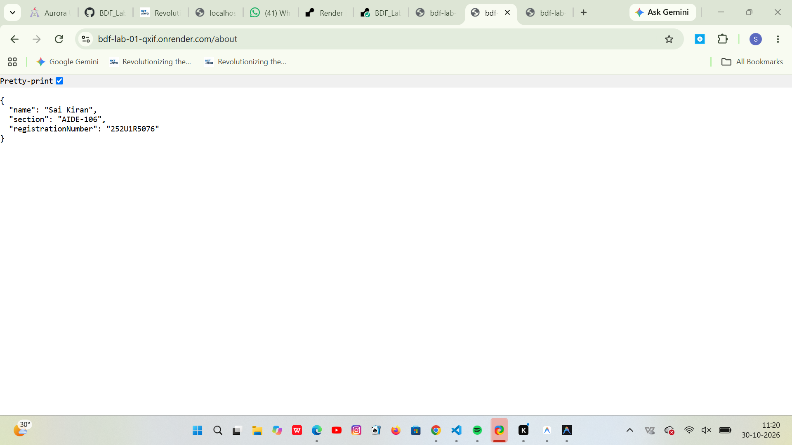
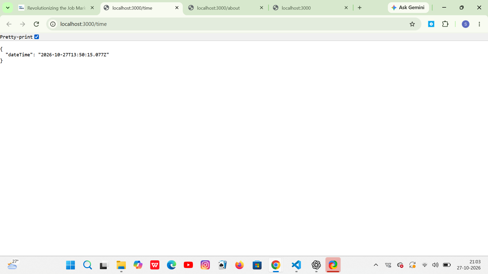

# BDF Lab 1 – Node.js and Express Server

**Student Name:** Sai Kiran  
**Registration Number:** 252U1R5076  
**Section:** AIDE-106  

---

## Project Description

This project is a lightweight HTTP web server built with **Node.js** and **Express**. It demonstrates foundational backend development concepts, including establishing an Express application, registering HTTP GET route handlers, serving plain text and structured JSON responses, and implementing a catch-all 404 middleware for undefined routes. The server is deployed publicly on **Render**.

---

## Technologies Used

| Technology | Purpose |
|------------|---------|
| **Node.js** (v18+) | JavaScript runtime environment |
| **Express** (^5.1.0) | Web framework for Node.js routing and HTTP server handling |
| **npm** | Package and dependency management |
| **Render** | Cloud platform for live web service deployment |

---

## Features

- **Root Route (`/`):** Returns a welcoming plain-text response (`Welcome to my server!`) with HTTP status 200.
- **Student Information Route (`/about`):** Returns structured JSON data containing the student's name, section, and registration number.
- **Server Date & Time Route (`/time`):** Returns dynamic JSON data containing the current server ISO timestamp generated via `new Date()`.
- **Catch-All 404 Error Handling:** Catches any undefined endpoint using middleware (`app.use()`) and returns an HTTP 404 status code with `404 - Page not found`.

---

## API Endpoints

| Method | Endpoint | Response Type | Description |
|--------|----------|---------------|-------------|
| `GET` | `/` | `text/plain` | Welcome message |
| `GET` | `/about` | `application/json` | Student metadata (name, section, registration number) |
| `GET` | `/time` | `application/json` | Current server date and time timestamp |
| `*` | Any undefined path | `text/plain` | 404 error handler for unmatched routes |

---

## Live Deployment

The application is deployed on **Render** and publicly accessible:

- **Live URL:** [https://bdf-lab-01-qxif.onrender.com](https://bdf-lab-01-qxif.onrender.com)
- **Home Endpoint:** [https://bdf-lab-01-qxif.onrender.com/](https://bdf-lab-01-qxif.onrender.com/)
- **About Endpoint:** [https://bdf-lab-01-qxif.onrender.com/about](https://bdf-lab-01-qxif.onrender.com/about)
- **Time Endpoint:** [https://bdf-lab-01-qxif.onrender.com/time](https://bdf-lab-01-qxif.onrender.com/time)

> **Note:** On Render's free tier, instances spin down after inactivity. The initial request after idle may take ~30 seconds while the service spins up.

---

## Screenshots

### Home Route (/)

### About Route (/about)

### Time Route (/time)

---

## Detailed Documentation

[Lab 1 README](lab-01/README.md)
